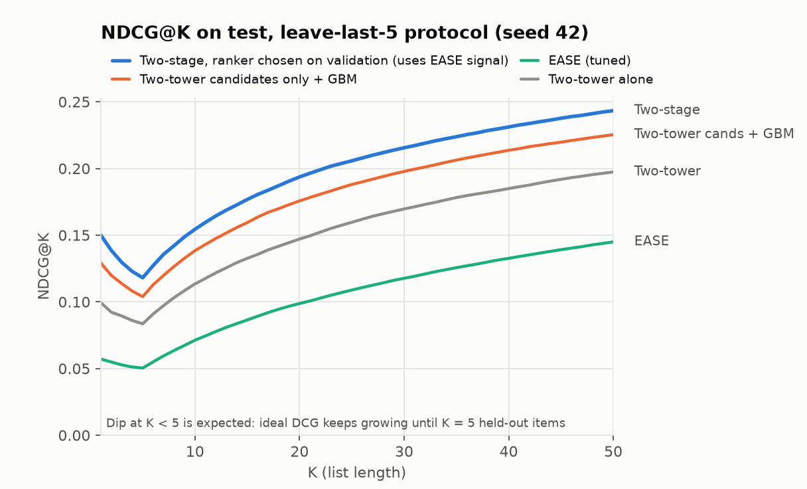

# Two-Stage Recommender: Two-Tower Retrieval + GBM Reranking

An end-to-end recommender on **MovieLens-1M** (1M ratings, 6,040 users, 3,706 movies):

1. **Retrieval:** a PyTorch two-tower model picks 200 candidates per user from the full catalog.
2. **Ranking:** a LightGBM LambdaRank model reorders them using 36 user, item and user×item features.
3. **Offline evaluation:** NDCG@K and Recall@K against tuned **EASE** and **Item-kNN** baselines,
   on 3 protocols, with 3 seeds and paired-bootstrap confidence intervals. Every modelling
   decision is made on validation, never on test.
4. **Serving:** per-request latency is measured, and FAISS HNSW is benchmarked against brute force up to 1M items.
5. **Online plan:** an A/B test design in [`AB_TEST_PLAN.md`](AB_TEST_PLAN.md).

## Headline results (test set; details in [`RESULTS.md`](RESULTS.md))

| Protocol | Two-tower | EASE (tuned) | **Two-stage** | Two-stage vs two-tower | Two-stage vs EASE |
|---|---|---|---|---|---|
| Leave-last-5, 3 seeds (NDCG@10) | 0.113 | 0.071 | **0.139** | **+22% to +24%** | **+93% to +96%** |
| Ratings ≥ 4 only (NDCG@10) | 0.086 | 0.072 | **0.113** | **+30%** | **+56%** |
| Global time split (NDCG@10) | 0.187 | **0.284** | 0.253 | +36% | **−11%** |



**What the experiments show:**

- **Recency is what wins.** Under leave-last-5, EASE weights a user's whole history
  equally and falls apart for heavy users. The reranker's lift grows with user activity:
  +16% for the lightest quarter of users, +31% for the heaviest.
- **The reranker's lift comes from combining signals, not from one feature.** Without the
  recency features the GBM is no better than the retriever. Sorting by recency alone is
  23% *worse*. The lift comes from the GBM learning to weigh them against the two-tower score.
- **On a strict global time split, EASE wins.** The bottleneck there is retrieval:
  two-tower candidates contain 32% of the held-out items, against 39% for EASE. The
  reranker can't recover items that were never retrieved. Next step: merge candidates from both.
- **Serving fits a real latency budget:** 10 ms p50 and 16 ms p99 end to end on one CPU
  thread, with the GBM taking 70% of that. Brute-force retrieval is fine up to about 50k items.
  At 1M items, HNSW is 5× faster at 97.6% recall.

## Architecture
```
user history ─┐
demographics ─┤ user tower ─┐
              │             ├─ dot product ─ top-200 ─► FeatureStore.transform ─► LightGBM LambdaRank ─► top-K
item id/genre/year ─ item tower ┘   (unseen items)    (precomputed offline)
```

**Two-tower model** (`recsys/two_tower.py`)
* User tower: user ID, gender, age, occupation, and the mean of the user's last 30 item
  embeddings. During training the history includes only items **before** the target, so
  the target can't leak into its own input.
* Item tower: item ID, genre multi-hot, and release-year bucket.
* Both towers output L2-normalized 64-dimensional vectors.
* Loss: in-batch softmax with temperature 0.05. A logQ correction offsets the popularity
  bias of in-batch negatives, and duplicate positives within a batch are masked.

**Reranker** (`recsys/features.py`, `recsys/ranker.py`)
* `FeatureStore` precomputes every user and item statistic offline from the history log.
  `transform()` is the cheap online step.
* Features: the two-tower score and rank; the candidate's similarity to the user's last 5
  items; item popularity (overall and recent), mean rating and age; user activity and mean
  rating; genre affinity; popularity, year and rating gaps between the item and the user's
  usual taste.
* Validation users are split into ranker-train users and ranker-holdout users. The holdout
  users drive early stopping and the choice between ranker variants.

**Baselines** (`recsys/baselines.py`): Popularity, Item-kNN (cosine, top-k neighbours) and
EASE (closed form). The tuning grids are wide enough that every chosen value is inside the
grid, not at its edge.

## Run it
```bash
python -m venv .venv
.venv/Scripts/pip install numpy pandas scikit-learn lightgbm faiss-cpu matplotlib pytest   # .venv/bin on macOS/Linux
.venv/Scripts/pip install torch --index-url https://download.pytorch.org/whl/cpu

.venv/Scripts/python -m pytest tests                          # 12 unit tests, about 5 s
.venv/Scripts/python run_pipeline.py                          # leave-last-5, seed 42 (about 25 min on CPU)
.venv/Scripts/python run_pipeline.py --seed 43                # more seeds
.venv/Scripts/python run_pipeline.py --protocol global        # global time split
.venv/Scripts/python run_pipeline.py --min-rating 4           # ratings >= 4 as positives
.venv/Scripts/python run_pipeline.py --reuse-stage1           # rerun baselines/rankers from cache (~3 min)
.venv/Scripts/python scripts/benchmark_serving.py             # latency + ANN benchmark
.venv/Scripts/python scripts/make_report.py                   # seed summary, segments, figures
```
Each run writes to `results/runs/<protocol>_minr<r>_seed<s>/`:
- `metrics_test.csv` and `metrics_val_holdout.csv`
- `results.json`, with the chosen hyperparameters and paired comparisons
- `feature_importance.csv`
- `ranker.txt`

The dataset downloads automatically.

## Layout
```
recsys/data.py          load ML-1M, leave-last-k and global time-split protocols
recsys/two_tower.py     stage 1 model, training, retrieval
recsys/features.py      FeatureStore: offline precompute, online transform
recsys/ranker.py        LightGBM LambdaRank, validation-based variant selection
recsys/baselines.py     Popularity, Item-kNN, EASE
recsys/metrics.py       Recall@K, NDCG@K, paired bootstrap
run_pipeline.py         end-to-end experiment
scripts/                serving benchmark, report and figures
tests/                  unit tests (metrics, split leakage, history gathering, baselines, features)
RESULTS.md              full results, ablations, caveats
AB_TEST_PLAN.md         online experiment design
```

## Next steps
1. **Use several candidate sources:** merge EASE and two-tower candidates, and give the
   GBM both scores as features. This targets the retrieval gap on the global time split.
2. **Sequential user tower** (SASRec-style): test whether it absorbs the recency lift the GBM gets today.
3. **Faster GBM:** cap the number of trees or compile the model (treelite) to cut the 7 ms scoring step.
4. **H&M dataset** (about 105k articles, real purchases): repeat the study on a catalog where ANN retrieval is needed.
