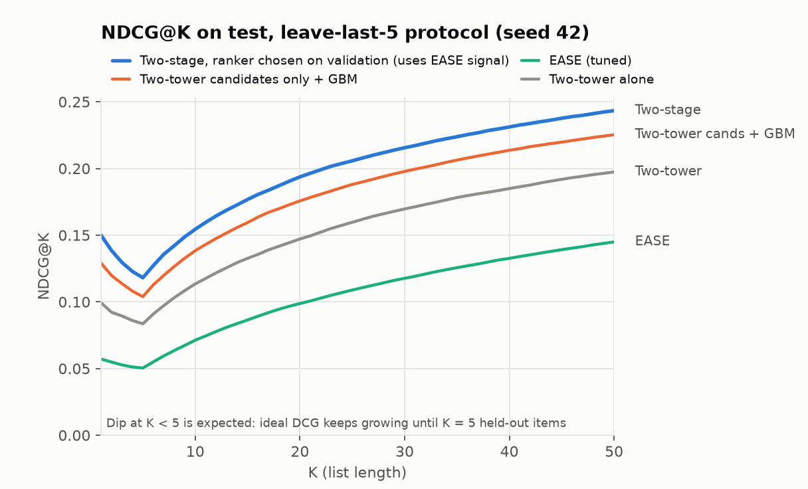
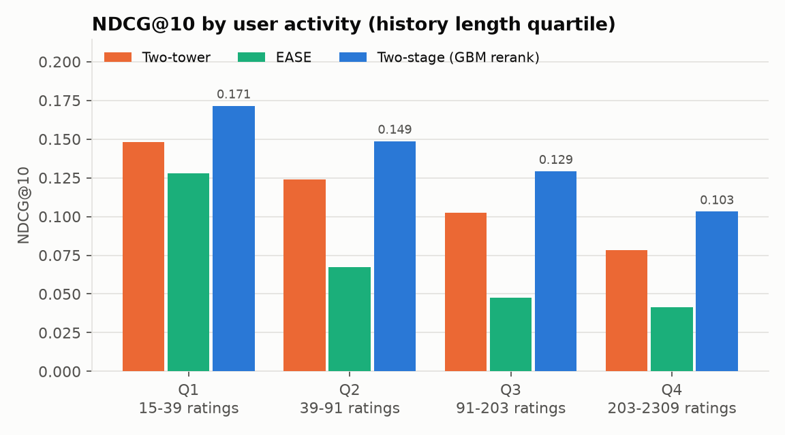
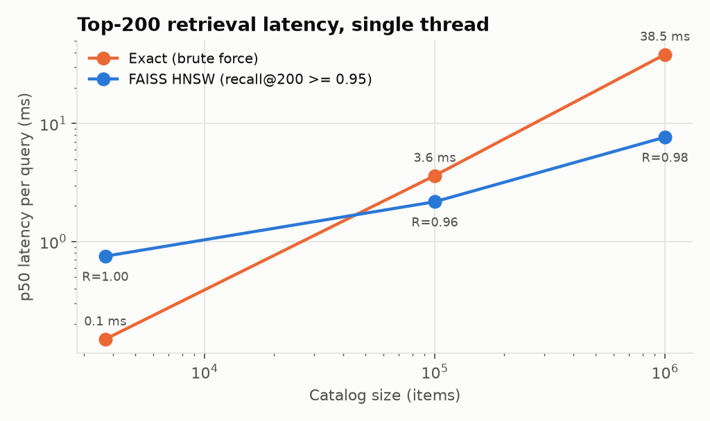

# Offline Results

Sections 1–6 cover **MovieLens-1M**. Section 7 repeats the study on **H&M** (105k articles,
real purchases).

Every number on this page is a **test-set** number. All modelling decisions were made
on validation before the test set was scored:

- baseline hyperparameters (EASE λ, Item-kNN k);
- which ranker variant and candidate pool to use;
- early stopping.

## Setup

| | |
|---|---|
| Users / items / ratings | 6,040 / 3,706 / 1,000,209 |
| Stage 1 candidates | **two-tower top 200 ∪ EASE top 200** per user, from the full catalog, items already seen removed. That's about 310 unique items per user. |
| Protocols | **leave-last-5** (per user), **global time split** (one clock), **leave-last-5 with ratings ≥ 4 as the only positives** |
| Seeds | 3 for leave-last-5 (42, 43, 44), 1 for each of the other protocols |
| Uncertainty | paired bootstrap over users (2,000 resamples) for every comparison; std across seeds |

**How a model decision is made.** Stage 1 and the features are fit on `train`, and
candidates are labeled with the `val` window. The validation users are then split 80/20:

- 80% train the LightGBM rankers;
- 20% are **ranker-holdout users**, used for early stopping and for picking the ranker
  variant with the best NDCG@10.

Baselines are tuned on the same validation window. For the test, everything is refit on
`train+val` and scored once.

**Ranker variants compared on validation.** Six LambdaRank models, each trained on one of
two candidate pools:

| Variant | Candidate pool | Features |
|---|---|---|
| GBM on two-tower candidates | two-tower top 200 | all except EASE (the earlier single-source system) |
| GBM on two-tower candidates + EASE feats | two-tower top 200 | all |
| Multi-source GBM (all features) | two-tower ∪ EASE | all |
| Multi-source GBM w/o recency sims / w/o two-tower feats / w/o EASE feats | two-tower ∪ EASE | ablations |

"EASE feats" are `ease_score` and `ease_rank`. Every candidate gets both sources' score
and rank, with the rank capped at 200 when that source didn't retrieve the item.

## 1. Main result: leave-last-5, mean ± std over 3 seeds

| System | NDCG@10 | Recall@10 | Recall@50 | Recall@200 |
|---|---|---|---|---|
| Popularity | 0.0327 | 0.0390 | 0.1375 | 0.3378 |
| Item-kNN (k = 800, tuned) | 0.0584 | 0.0695 | 0.2145 | 0.4649 |
| EASE (λ = 1000, tuned) | 0.0712 | 0.0871 | 0.2902 | 0.6003 |
| Two-tower (stage 1 only) | 0.1130 ± 0.0016 | 0.1325 ± 0.0021 | 0.3629 ± 0.0009 | 0.6269 ± 0.0025 |
| Two-tower candidates + GBM (earlier single-source system) | 0.1392 ± 0.0009 | 0.1600 ± 0.0003 | 0.3985 ± 0.0036 | 0.6269 ± 0.0025 |
| **Two-stage, ranker chosen on validation** | **0.1582 ± 0.0034** | **0.1807 ± 0.0041** | **0.4313 ± 0.0131** | 0.6727 ± 0.0400 |
| *(Multi-source GBM, all features, on every seed)* | *0.1601 ± 0.0007* | *0.1831 ± 0.0007* | *0.4379 ± 0.0018* | *0.6950 ± 0.0016* |

The baselines are deterministic, so they have no spread across seeds.

**Validation picked the multi-source GBM on seeds 43 and 44.** On seed 42 it picked the GBM
on two-tower candidates with EASE scores as features. On the 1,208 ranker-holdout users, the
two were 0.001 NDCG@10 apart (0.1763 vs 0.1751), which is within noise. On test, the
multi-source GBM would have been 0.006 better on that seed. I report what validation chose,
not what test would have preferred. That's why the "selected" row has a larger spread than
either variant on its own.

**Paired lift in NDCG@10 for the selected system, by seed:**

| Compared with | Seed 42 | Seed 43 | Seed 44 |
|---|---|---|---|
| Two-tower | +36.1% [+32.1, +40.2] | +43.3% [+38.8, +47.6] | +40.7% [+36.5, +45.4] |
| EASE | +116.8% [+107.3, +126.3] | +123.8% [+114.2, +134.9] | +125.7% [+116.0, +136.9] |
| Item-kNN | +164.2% [+150.7, +178.0] | +172.8% [+159.5, +188.0] | +175.2% [+162.0, +190.1] |
| Single-source GBM (two-tower candidates) | +11.6% [+9.4, +13.7] | +14.5% [+12.3, +16.8] | +14.7% [+12.7, +17.1] |

**Candidate recall.** On test, with 200 candidates from each source:

| Source | Recall over all candidates |
|---|---|
| Two-tower only | 0.627 |
| EASE only | 0.600 |
| Union (about 310 items) | 0.745 |

The two sources overlap much less than their similar recall suggests.

### Results by user activity

NDCG@10 by user activity quartile, seed 42 (the selected two-stage system is the two-tower-candidate GBM with EASE features):

| User activity quartile | Users | Two-tower | EASE | Single-source GBM | Two-stage | vs two-tower | vs EASE | vs single-source GBM |
|---|---|---|---|---|---|---|---|---|
| Q1 (15–39 ratings) | 1,522 | 0.148 | 0.128 | 0.169 | 0.195 | +32% [+25, +39] | +52% [+45, +61] | +15% [+11, +19] |
| Q2 (39–91) | 1,516 | 0.124 | 0.067 | 0.152 | 0.164 | +32% [+25, +40] | +144% [+120, +169] | +8% [+4, +12] |
| Q3 (91–203) | 1,499 | 0.103 | 0.047 | 0.129 | 0.142 | +38% [+30, +48] | +199% [+166, +238] | +10% [+6, +14] |
| Q4 (203–2,309) | 1,503 | 0.079 | 0.042 | 0.103 | 0.116 | +48% [+39, +60] | +180% [+146, +219] | +14% [+9, +19] |

EASE scores a user's whole history as an unordered set, and leave-last-5 asks what the user
rates **next**. For heavy users an unordered history is dominated by old taste, so EASE
alone collapses: its NDCG@10 is about half the two-tower model's in Q4. But EASE still adds
a lot **as a feature**, including for heavy users. The GBM learns how far to trust the
long-term co-occurrence signal next to the recency features.

## 2. Where does the lift come from? Ablations (concern 2)

Same seeds; mean NDCG@10 over 3 seeds.

| Ranking | Candidates | NDCG@10 | vs two-tower order |
|---|---|---|---|
| Two-tower score (no reranking) | two-tower | 0.1130 | – |
| `sim_recent_max` alone (heuristic) | two-tower | 0.0872 | −23% |
| GBM, no EASE features | two-tower | 0.1392 | +23% |
| GBM, all features | two-tower | 0.1556 | +38% |
| GBM w/o recency sims | union | 0.1330 | +18% |
| GBM w/o EASE features | union | 0.1422 | +26% |
| GBM w/o two-tower score and rank | union | 0.1543 | +37% |
| **GBM, all features** | **union** | **0.1601** | **+42%** |

- **Recency features are still the most important group.** Removing them costs the most:
  0.1601 → 0.1330, −17%. On their own they're 23% *worse* than the two-tower order. The GBM
  needs them as one input among several.
- **Under leave-last-5, EASE helps mostly as a feature, not as a candidate source.** On the
  same two-tower candidates, EASE features raise NDCG@10 by 12% (0.1392 → 0.1556). Adding
  EASE's candidates adds another 3% (→ 0.1601), and recall@200 after reranking goes from
  0.627 to 0.695. EASE candidates without EASE features barely help (0.1422).
- **The two-tower score matters least.** Removing it costs 4%, because EASE score and the
  recency similarities cover much of the same ground.

Top features by gain (seed 43, multi-source): `tt_rank` 16.4%, `ease_score` 12.0%,
`sim_recent_max` 11.9%, `sim_last` 7.8%, `ease_rank` 7.7%, `tt_score` 5.2%.

## 3. Global time split (concern 4)

Here there is one clock. Training uses everything before 2000-12-02, validation covers
2000-12-02 to 2000-12-29, and test is everything after 2000-12-29. That's the last 10% of
ratings, spread over two years. The test covers 1,175 users with at least 5 earlier
ratings, averaging about 81 held-out items each.

| System | NDCG@10 | Recall@10 | Recall@50 | Recall@200 |
|---|---|---|---|---|
| Popularity | 0.2536 | 0.0393 | 0.1428 | 0.3418 |
| Item-kNN (k = 1600) | 0.2653 | 0.0427 | 0.1355 | 0.3273 |
| EASE (λ = 32000) | 0.2836 | 0.0508 | 0.1629 | 0.3857 |
| Two-tower (stage 1 only) | 0.1866 | 0.0370 | 0.1234 | 0.3166 |
| GBM on two-tower candidates (earlier system) | 0.2539 | 0.0558 | 0.1557 | 0.3166 |
| GBM on two-tower candidates + EASE feats | 0.2701 | 0.0588 | 0.1627 | 0.3166 |
| Multi-source GBM, all features | 0.2987 | 0.0672 | 0.1878 | 0.4094 |
| **Two-stage, selected: multi-source GBM w/o two-tower feats** | **0.3026** | **0.0689** | **0.1932** | **0.4109** |

**With multi-source candidates, the two-stage system now beats EASE on the strict time split.**
The earlier single-source system lost to EASE by 10.7%.

| Selected two-stage vs… | NDCG@10 | Recall@10 | Recall@50 |
|---|---|---|---|
| EASE | **+6.7% [+2.2, +11.4]** | +35.8% [+21.6, +51.7] | +18.6% [+13.9, +23.8] |
| Single-source GBM | +19.2% [+15.3, +23.5] | +23.5% [+13.4, +35.1] | +24.1% [+19.3, +29.0] |
| Two-tower | +62.1% [+52.6, +72.8] | +86.1% [+63.0, +113.5] | +56.5% [+46.9, +66.3] |

What changed, and what didn't:

- **Retrieval was the bottleneck, and the union fixes it.** Candidate recall:

  | Source | Recall over all candidates |
  |---|---|
  | Two-tower | 0.317 |
  | EASE | 0.386 |
  | Union (about 313 items) | **0.487** |

  On this split, EASE features on the two-tower candidates alone aren't enough
  (0.2701 < EASE's 0.2836). The extra candidates are what put the system ahead.
- **The test is different in kind.** It mostly asks what the user will rate over the
  coming months. Top features are `item_year` (20%), `ease_rank` (14%) and recent item
  popularity (12%). Validation dropped the two-tower features entirely.
- **The win holds across close variants.** Three of the four union-pool variants beat EASE
  on test, from 0.2891 to 0.3026. The one that doesn't is the variant without EASE features
  (0.2502).
- **Validation data is thin.** Only 520 users are active in the validation window, and the
  ranker-holdout split has 104. The rankers early-stop after 2 to 48 trees, so ranker
  selection on this protocol is noisy.

## 4. Only ratings ≥ 4 count as positives (concern 5)

History still includes every rating, since the user has seen those films. Only ratings of
4 and 5 count as targets, both for the two-tower training loss and for evaluation. The test
covers 5,553 users. Validation selected the multi-source GBM with all features.

| System | NDCG@10 | Recall@10 | Recall@50 | Recall@200 |
|---|---|---|---|---|
| EASE (λ = 2000) | 0.0722 | 0.1027 | 0.3236 | 0.6415 |
| Two-tower | 0.0864 | 0.1208 | 0.3373 | 0.6049 |
| Single-source GBM | 0.1135 | 0.1549 | 0.3779 | 0.6049 |
| **Two-stage (multi-source)** | **0.1297** | **0.1790** | **0.4264** | **0.6979** |

Lift in NDCG@10 for the two-stage system:

| Two-stage vs… | NDCG@10 lift | 95% CI |
|---|---|---|
| Two-tower | **+50.0%** | [+44.0, +56.9] |
| EASE | **+79.7%** | [+70.2, +89.8] |
| Single-source GBM | **+14.3%** | [+11.0, +17.8] |

Here EASE is the better *retriever*, with recall@200 of 0.642 against 0.605 for the
two-tower model, because liked items are more predictable from the full history. The
multi-source pool picks that up.

## 5. Serving latency (concern 6)

Measured with `scripts/benchmark_serving.py` on a single thread, 1,000 requests after
warm-up. The model is seed 43's: multi-source candidates and a LightGBM ranker with 191
trees, scoring about 310 candidates per request.

| Step | p50 | p95 | p99 |
|---|---|---|---|
| User tower (history → embedding) | 0.6 ms | 0.9 ms | 1.1 ms |
| Retrieval: two-tower top 200 + EASE top 200 + union | 0.6 ms | 2.8 ms | 6.6 ms |
| Feature transform (about 310 candidates, precomputed store) | 0.8 ms | 1.3 ms | 1.6 ms |
| GBM scoring (about 310 × 38) | 6.1 ms | 8.0 ms | 9.1 ms |
| **End to end** | **8.2 ms** | **12.6 ms** | **16.6 ms** |

- **EASE retrieval** is `B[seen].sum(0)` over a dense 3.7k × 3.7k matrix. The p99 comes
  from heavy users with thousands of rated items. At a larger catalog, B would be sparsified
  (top-k per row) or the EASE candidates precomputed per user offline.
- **The GBM is still about 75% of the latency.** It scales with candidates × trees.
  Seed 42's selected ranker (200 candidates, 75 trees) runs at 3.1 ms p50 and 8.8 ms p99 end
  to end; that run is saved in `results/serving_benchmark_seed42.json`.
- **Cheap ways to cut it:** cap the number of trees, score fewer candidates, or compile the
  model (treelite or lleaves).
- **Offline batch job:** building the history index, item embeddings, feature store and
  EASE B takes 5.3 s.

**Retrieval at scale.** The synthetic catalogs are real item vectors plus noise, with
500 queries each, top 200, on a single thread.

| Catalog | Exact p50 | HNSW ef=256 | HNSW ef=512 | HNSW ef=1024 | HNSW build |
|---|---|---|---|---|---|
| 3.7k | 0.15 ms | 0.75 ms, recall 1.000 | 1.5 ms, 1.000 | 3.9 ms, 1.000 | 1 s |
| 100k | 3.6 ms | 2.2 ms, 0.960 | 4.7 ms, 0.992 | 8.7 ms, 0.999 | 32 s |
| 1M | **38.5 ms** | 2.0 ms, 0.824 | 3.6 ms, 0.927 | **7.7 ms, 0.976** | 10 min |

Brute force wins below about 50k items, so ML-1M correctly uses no ANN index. At 1M items,
HNSW is 5× faster at 97.6% recall, and the index needs to be rebuilt offline, which takes
10 minutes per rebuild on this machine.

## 6. The `user_occ` decision, restated on validation (concern 3)

The first version had a user-occupation feature. It was removed because it made **validation**
NDCG@10 worse on the users held out from ranker training: 0.1901 with it, 0.1974
without it. These are LightGBM's own NDCG@10 over each holdout user's candidates, from
the earlier pipeline's 10% holdout. The cause: early stopping triggered at 74 trees instead of 152, because splits
on a feature that is constant within each user overfit. The test-set comparison was
reported only after that decision. The pipeline now enforces this rule for every ranker
variant.

## 7. H&M: 105k articles, real purchases

Produced by `run_hm.py` (seed 42, about 29 minutes on CPU). Outputs are in `results/hm/`
and the log is `results/logs/hm_full.log`.

| | |
|---|---|
| Data | 31.8M purchases, 1.37M customers, 105,542 articles (2018-09 to 2020-09) |
| Protocol | the Kaggle competition's. **Test** = the last week (2020-09-16 to 22), **validation** = the week before. Each stage sees a 12-week history window strictly before its target week. |
| Evaluated users | customers who buy in the target week *and* have history in the window: 49,219 of 68,984 test-week buyers (71%), buying 3.1 items on average |
| Metric | **MAP@12** (the competition metric), plus Recall@12 and NDCG@12 |
| Seeds | 1 (42) |

**Candidates.** Four sources, unioned per user (about 165 unique articles per user):

- **Two-tower top 100.** It retrieves from the articles sold in the last 4 weeks. The user
  tower has no customer-ID embedding (1.37M IDs, most with a handful of purchases); it uses
  age, club status, newsletter frequency and the mean of the last 20 purchases. The item
  tower has the article ID plus 8 catalog attributes. It's trained once with logQ
  correction, for 3 epochs on the validation-stage history, and reused at test time with
  user embeddings recomputed from the newer history.
- **EASE top 50**, over the 8,000 best-selling articles of the last 4 weeks.
- **Re-buy:** up to 30 articles the customer bought before.
- **Popular:** last week's 30 best-sellers.

**Decisions on validation.** EASE λ was picked on the validation week (λ = 50). Three
LambdaRank variants were trained on 9,600 validation users, and the one with the best MAP@12
on the other 2,400 (ranker-holdout) users was selected:

| Variant (ranker-holdout users, validation week) | MAP@12 | Recall@12 | NDCG@12 | Trees |
|---|---|---|---|---|
| GBM on two-tower candidates | 0.0224 | 0.0459 | 0.0344 | 128 |
| Multi-source GBM, all features | 0.0406 | 0.0841 | 0.0596 | 55 |
| **Multi-source GBM w/o two-tower feats (selected)** | **0.0411** | 0.0840 | **0.0599** | 26 |

**Test results (49,219 users):**

| System | MAP@12 | Recall@12 | NDCG@12 |
|---|---|---|---|
| Popularity (last week) | 0.0091 | 0.0255 | 0.0161 |
| Re-buy, then popular | 0.0331 | 0.0634 | 0.0462 |
| EASE (λ = 50) | 0.0148 | 0.0394 | 0.0247 |
| Two-tower (stage 1 only) | 0.0069 | 0.0201 | 0.0125 |
| GBM on two-tower candidates | 0.0171 | 0.0346 | 0.0257 |
| Multi-source GBM, all features | 0.0377 | 0.0776 | 0.0546 |
| **Two-stage, selected: multi-source GBM w/o two-tower feats** | **0.0381** | **0.0780** | **0.0550** |

Paired lift in MAP@12 for the selected system (bootstrap over users, 95% CI):

| Selected two-stage vs… | MAP@12 lift | 95% CI |
|---|---|---|
| Re-buy, then popular | **+15.0%** | [+12.6, +17.4] |
| EASE | +157.1% | [+144.6, +170.0] |
| GBM on two-tower candidates | +123.4% | [+113.7, +134.0] |
| Popularity (last week) | +318.8% | [+291.9, +350.0] |
| Two-tower | +450.2% | [+413.9, +488.3] |
| Multi-source GBM, all features | +1.1% | [−0.3, +2.6] |

GBM on two-tower candidates vs two-tower alone: +146.3% [+131.1, +163.4].

**Candidate recall on test** (share of a user's purchased articles that a source retrieves):

| Source | Recall |
|---|---|
| Two-tower top 100 | 0.077 |
| EASE top 50 | 0.085 |
| Re-buy (≤ 30) | 0.053 |
| Popular (30) | 0.052 |
| **Union (about 165 per user)** | **0.185** |

What this shows:

- **The two-stage system beats the strongest simple baseline.** "Re-buy, then popular" is
  the hard baseline on this data, and the multi-source GBM beats it by 15% on MAP@12. On
  the smoke runs (4-week window, 1 epoch, 3,000 test users) this comparison was −3% to
  −4% and not significant; on the full data it is clearly positive.
- **Retrieval is the bottleneck.** The union holds only 18.5% of what users buy, so no
  ranker on these candidates can exceed that recall. Each source on its own finds 5–9%, and
  they overlap little.
- **The two-tower model is a candidate source, not a ranking signal.** On its own it ranks
  below last-week popularity (MAP@12 0.0069 vs 0.0091). As a source its recall (7.7%) is
  close to EASE's (8.5%). As ranker features it adds nothing: with and without them the
  multi-source GBM is within 1.1% [−0.3, +2.6], and validation preferred the version
  without them.
- **Candidates matter more than features here.** The GBM restricted to two-tower
  candidates scores less than half the multi-source GBM. The opposite of MovieLens
  leave-last-5, where EASE helped mostly as a feature.
- **What the selected ranker uses.** Top features by gain: `i_department_no` 18.2%,
  `ui_days_since` 13.8%, `u_product_code_cnt` 10.3%, `u_days_since_last` 8.0%,
  `i_log_sales_1w` 7.9%, `ease_score` 5.4%. Recency and recent popularity dominate, as
  is typical for fashion purchases.

**H&M-specific caveats:**

- **One seed.** The CIs cover variation across users, not across training runs.
- **EASE λ = 50 is at the bottom edge of the grid** {50, 200, 800, 3200}; validation MAP@12
  was still rising as λ fell (0.0145 → 0.0162). A lower λ might give a stronger EASE
  baseline and better EASE candidates.
- **29% of test-week buyers aren't scored**, because they have no purchase in the 12-week
  window. They are cold-start users for every system here.
- **logQ matters for the two-tower model.** On the smoke setting (3,000 test users),
  training without the logQ correction cut its candidate recall from 0.089 to 0.010. That
  comparison has not been repeated on the full run.

## Caveats

- **Seeds.** Only the leave-last-5 protocol has 3 seeds; global and ratings ≥ 4 have one
  each, as does H&M. The bootstrap CIs cover variation across users, not across runs.
- **Ranker selection is noisy at the top.** On seed 42, the two best variants were 0.001
  apart on validation. The global split has only 104 ranker-holdout users.
- **Labels.** "Rated it" is still not "clicked it when shown". There's no impression or
  position data, which is why the A/B test is still needed (`AB_TEST_PLAN.md`).
- **Latency across sessions.** Benchmarks run in different sessions are not directly
  comparable. The single-source benchmark in the earlier commit measured a slower user tower
  on the same code, so machine load differed.
- **Synthetic catalog.** The 100k/1M catalogs are synthetic, so HNSW recall on a real large
  catalog will differ.
